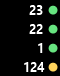

# Froggo mod demonstrations

Real Windows captures recorded on October 23, 2026. These assets are kept on a
separate branch so each Windhawk submission still changes only its mod source.

## Froggo Desktop Ping Panel

The compact running widget displays four latency readings and status indicators.

## Froggo Explorer Emmet Folders

[Watch or download the MP4 recording](froggo-explorer-emmet-folders/demo.mp4).

The native rename editor receives `Project {1..3}/Assets+Exports`. The mod creates
three project folders, each containing `Assets` and `Exports`. The recording then
opens `Project 1` to show its children. All nine resulting directories were
verified on disk. Only a dedicated dummy folder is shown.

## Froggo Explorer Mixed Sorting

Both captures show the same six dummy items, sorted by **Date modified,
descending**, with **Group by: None**. Only `mixDateModified` changes between
captures. Its original value was restored after the comparison.

### Before: mixed sorting off

### After: mixed sorting on

Explorer captures exclude the tab strip and navigation sidebar so personal tabs,
pinned folders, and unrelated locations are not included.

## Froggo Toast Tamer

No visual evidence is included yet. Dummy notifications sent through WinRT and
the system tray did not produce a visible banner in this session. A screenshot
of an absent banner would not demonstrate click-through or swipe snoozing.

## Runtime provenance

The recordings use the existing installed mods. Their saved sources match the
submitted sources apart from Froggo naming and the GitHub author metadata.
The installed Ping Panel and Emmet IDs still use their original names;
recording these demonstrations did not install the renamed mods. This source
comparison does not independently establish how the loaded DLLs were built.
